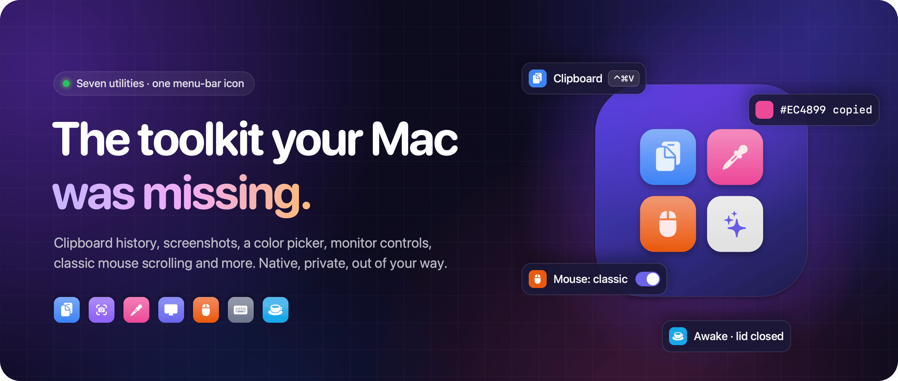
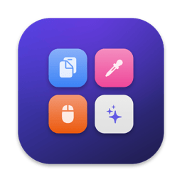

<div align="center">

<a href="https://makitro.mdali.dev">
  
</a>

<br>
<br>

<a href="https://github.com/itsproali/makitro/releases/latest/download/Makitro.dmg"></a>

<br>

[](https://github.com/itsproali/makitro/releases/latest)
[](https://github.com/itsproali/makitro/releases)
[](#requirements)
[](#requirements)
[](#install)

**[Website](https://makitro.mdali.dev)** &nbsp;·&nbsp;
**[What's new](https://github.com/itsproali/makitro/releases/latest)** &nbsp;·&nbsp;
**[Pricing](https://makitro.mdali.dev/pricing)** &nbsp;·&nbsp;
**[Report a bug](https://github.com/itsproali/makitro/issues/new)** &nbsp;·&nbsp;
**[Support](https://makitro.mdali.dev/support)**

</div>

<br>

Makitro is one small, native menu-bar app for the annoying parts of macOS. Seven utilities sit behind a single
icon, each with its own switch. A utility that's off runs nothing and never asks for a permission.

```bash
brew install --cask itsproali/tap/makitro
```

<div align="center">
  <a href="https://makitro.mdali.dev/#demo">
    
  </a>
</div>

## What's inside

<table>
  <tr>
    <td width="50%" valign="top">
      <br>
      <b>Clipboard History</b> &nbsp;<kbd>⌃</kbd><kbd>⌘</kbd><kbd>V</kbd><br>
      <sub>Text, links, colours and images, kept on your Mac. Search, pin favourites, paste with ⌘1–⌘9. Password-manager copies are never saved.</sub>
    </td>
    <td width="50%" valign="top">
      <br>
      <b>Screenshot</b> &nbsp;<kbd>⌃</kbd><kbd>⌘</kbd><kbd>4</kbd><br>
      <sub>Area, window or screen. Copy, save or drag it, or annotate with arrows, shapes, text, spotlight and pixelate, on a background ready to share.</sub>
    </td>
  </tr>
  <tr>
    <td width="50%" valign="top">
      <br>
      <b>Color Picker</b> &nbsp;<kbd>⌃</kbd><kbd>⌘</kbd><kbd>C</kbd><br>
      <sub>Any pixel on any screen, copied as HEX, <code>rgb()</code> or <code>hsl()</code>. No Screen Recording permission.</sub>
    </td>
    <td width="50%" valign="top">
      <br>
      <b>Monitor Controls</b><br>
      <sub>Brightness, contrast and volume for external monitors (over DDC/CI, or in software when the cable blocks it), sharp HiDPI sizes, and soft eject.</sub>
    </td>
  </tr>
  <tr>
    <td width="50%" valign="top">
      <br>
      <b>Scroll Reverser</b><br>
      <sub>Classic scrolling on the mouse wheel, natural scrolling on the trackpad, both at once. Turns itself on when a mouse is connected.</sub>
    </td>
    <td width="50%" valign="top">
      <br>
      <b>Keyboard Cleaning</b><br>
      <sub>Locks every key, media and brightness keys included, while you wipe it down. One click or a 1–5 minute timer ends it.</sub>
    </td>
  </tr>
  <tr>
    <td width="50%" valign="top">
      <br>
      <b>Keep Awake</b><br>
      <sub>Keeps your Mac running for coding agents, builds and downloads, even with the lid closed. No admin password. Stops on low battery.</sub>
    </td>
    <td width="50%" valign="top">
      <br>
      <b>More on the way</b><br>
      <sub>Window Management is next: halves, quarters and thirds from the keyboard or by dragging to an edge. Included when it ships.</sub>
    </td>
  </tr>
</table>

Shortcuts can be changed in Settings. Right-click the menu-bar icon for a quick menu.

## Why Makitro

- **Native, not a web page.** Written in Swift. Opens instantly and looks like the rest of your Mac.
- **Off means off.** No timers, event taps or polling for tools you don't use. Idle cost is close to zero.
- **Permissions on request.** Asked for only when you turn on the tool that needs one, with the reason first.
- **Private by design.** No account, no cloud, no analytics. Your clipboard never leaves your Mac.

## Install

<table>
  <tr>
    <td width="50%" valign="top">
      <b>Homebrew</b>
      <pre lang="bash">brew install --cask itsproali/tap/makitro</pre>
    </td>
    <td width="50%" valign="top">
      <b>Direct download</b>
      <ol>
        <li>Download <a href="https://github.com/itsproali/makitro/releases/latest/download/Makitro.dmg"><b>Makitro.dmg</b></a>.</li>
        <li>Open it and drag <b>Makitro</b> to <b>Applications</b> (or open it from the disk image and let it move itself).</li>
        <li>Look for it in the menu bar. There's no Dock icon.</li>
      </ol>
    </td>
  </tr>
</table>

Makitro is signed with an Apple Developer ID and notarized by Apple, so it opens like any app from the web.

> [!TIP]
> **Updating from 0.9.0 or 0.9.1?** Those previews weren't notarized. After updating, macOS asks once more for
> Accessibility (and any other permission you gave Makitro). Turn it on again in **System Settings › Privacy &
> Security**. Your settings and history are kept.

### Requirements

- macOS 14 Sonoma or later
- Apple silicon or Intel Mac

## Pricing

> [!NOTE]
> **Makitro is free during the developer preview.** Every utility works and no trial runs.

From 1.0, Makitro is a paid app with a fair deal:

| | |
|---|---|
| **Free trial** | 14 days, every utility. No card, no account. |
| **Price** | **$19 once** ($14.99 at launch). No subscription, no renewals. |
| **Your license** | Use it on 2 Macs. It never expires and is checked offline, on your Mac. |
| **Updates** | All 1.x updates included. 14-day refunds. |

Details on the [pricing page](https://makitro.mdali.dev/pricing).

## Privacy

Makitro is built to be trusted with your clipboard.

- **Everything stays on your Mac.** No account, no cloud sync, no analytics, no tracking.
- **The only network request is the update check**, and Makitro asks before checking automatically. It sends
  nothing about you or your Mac. Check it yourself with [Little Snitch](https://www.obdev.at/products/littlesnitch/)
  or [LuLu](https://objective-see.org/products/lulu.html).
- Clipboard history lives in `~/Library/Application Support/dev.mdali.Makitro/`, readable only by your user
  account and kept out of Time Machine. Clear History deletes it for real.
- Copies that password managers mark as private (the standard nspasteboard.org markers) are never recorded.
- Windows that show clipboard content are hidden from screen sharing and recordings.
- Screenshots and picked colours stay on your Mac.

Full details: [privacy policy](https://makitro.mdali.dev/privacy).

## Permissions

Makitro asks for a permission only when you use something that needs it, never at launch, and always
explains why first.

| Permission | Used by | Why |
|---|---|---|
| Accessibility | Scroll Reverser | To change the scroll direction of mouse events |
| Accessibility | Keyboard Cleaning | To block key presses during a cleaning session |
| Accessibility | Clipboard History (optional) | To paste the item you choose. Without it, Makitro copies instead |
| Screen Recording | Screenshot | To capture the area, window or screen you pick. Asked the first time you capture |

Color Picker, Monitor Controls and Keep Awake need no permission. Input Monitoring is never requested.

## Updates

Makitro updates itself through [Sparkle](https://sparkle-project.org). Every update is verified with a
cryptographic signature before it's installed. To check manually, use **Check for Updates…** in the menu-bar
menu or under **General › Updates**. Homebrew installs update the same way.

Release notes for every version: [Releases](https://github.com/itsproali/makitro/releases) ·
[What's new](https://makitro.mdali.dev/changelog).

## Uninstall

Quit Makitro, then delete it from Applications. To remove your data as well:

```bash
rm -rf ~/Library/Application\ Support/dev.mdali.Makitro
defaults delete dev.mdali.Makitro
```

With Homebrew: `brew uninstall --zap --cask makitro`.

## Feedback and support

- **Bugs:** use **Report a Bug** in Makitro's menu-bar menu (it opens a pre-filled email you can edit), or
  [open an issue](https://github.com/itsproali/makitro/issues/new). Include your Makitro and macOS versions;
  **General › Help & feedback › Copy Diagnostics** copies them for you.
- **Questions and ideas:** [itsproali@gmail.com](mailto:itsproali@gmail.com). A person reads every email.
- **Help:** [makitro.mdali.dev/support](https://makitro.mdali.dev/support)

## About this repository

This repository hosts Makitro's releases and issue tracker. The source code isn't public.

<div align="center">
<br>
<a href="https://makitro.mdali.dev"></a>
<br>
<sub>© 2026 Mohammad Ali. All rights reserved.</sub>
</div>
